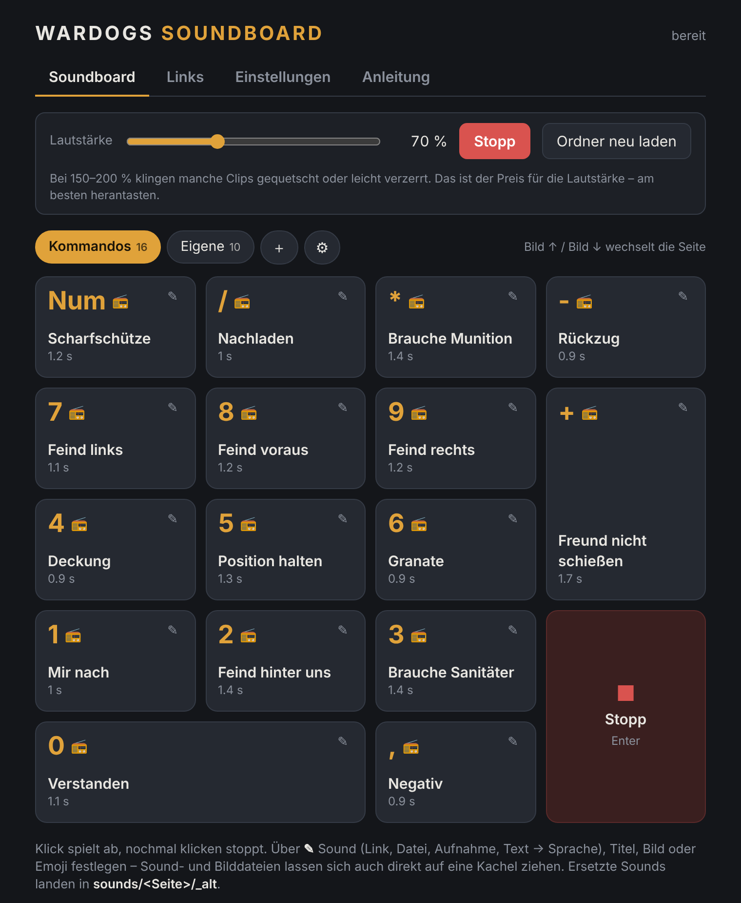
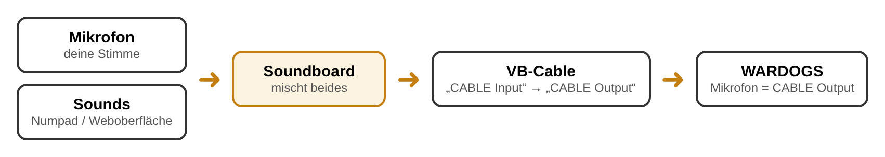
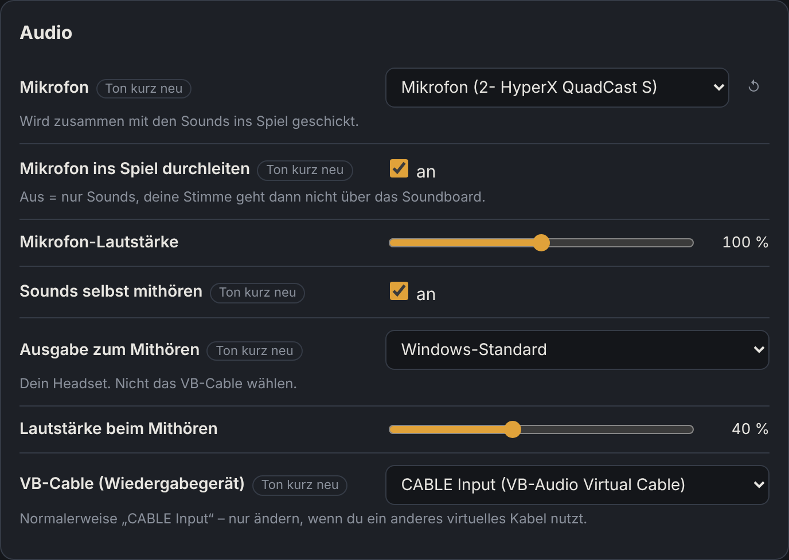

# WARDOGS Soundboard

**🇩🇪 [Deutsch](#deutsch) · 🇬🇧 [English](#english)**

Ein Soundboard für den Proximity-Voice-Chat von **WARDOGS** (Bulkhead) – Meme-Sounds per Numpad-Taste, wie früher die Saysounds auf Counter-Strike-Servern.
A soundboard for the proximity voice chat in **WARDOGS** (Bulkhead) – meme sounds on your numpad, like the old Counter-Strike saysounds.

**[⬇ Download (neueste Version / latest release)](https://github.com/TARLoki/wardogs-soundboard/releases/latest)** · **[📖 Wiki](https://github.com/TARLoki/wardogs-soundboard/wiki)**

> **Neu in 2.1 / New in 2.1:** Reiter **Einstellungen** (Mikrofon, Sprechtaste, Lautstärken per Auswahlfeld) und **Links** (Webseiten, die die Desktopverknüpfung mit öffnet) – beides bleibt bei Updates erhalten. / **Settings** and **Links** tabs – both kept across updates.

---

## Deutsch

### Was es kann

- **16 Sound-Tasten** auf dem Nummernblock (0–9, `,` `/` `*` `-` `+`, NumLock), Numpad-Enter stoppt alles
- **Mehrere Seiten** (z. B. „Kommandos“, „Eigene“, „Memes“) – umschalten mit **Bild ↑ / Bild ↓**, der Seitenname wird im eigenen Headset angesagt
- **Kommando-Vorlage:** 16 typische Ansagen („Feind links!“, „Granate!“ …) per Text-to-Speech mit **Funk-Effekt**
- **Weboberfläche** im Browser (`http://localhost:8765`) – auch vom Handy aus bedienbar
- **Sounds von [Myinstants](https://www.myinstants.com) per Link**, eigene Dateien (WAV, MP3, OGG, FLAC), **eigene Aufnahmen** übers Mikrofon oder **Text → Sprache** (Windows-Stimme)
- **Bilder oder Emojis** als Kachelhintergrund – Bilder bleiben in einer Bibliothek und lassen sich wiederverwenden
- **Eigene Titel** je Taste, Lautstärke bis 200 % mit Soft-Limiter, leise Clips werden automatisch angehoben
- **Push-to-Talk automatisch:** hält beim Abspielen die Sprechtaste (Standard `K`) gedrückt – nur wenn WARDOGS das aktive Fenster ist
- **Einrichtungs-Check** mit Schritt-für-Schritt-Anleitung direkt in der Oberfläche
- **Einstellungen in der Oberfläche:** Mikrofon, Sprechtaste, Lautstärken & Co. per Auswahlfeld – bleiben bei Updates erhalten
- **Desktopverknüpfung**, die Soundboard und WARDOGS zusammen startet und das Soundboard nach dem Spiel beendet – auf Wunsch mit deinen Lieblings-Webseiten aus dem Reiter **Links**
- **Update-Hinweis**, sobald hier eine neue Version erscheint (nur Hinweis, keine automatische Installation)

### So funktioniert es

Das Spiel wird **nicht verändert** – keine Dateien, kein Speicherzugriff. Das Soundboard mischt dein Mikrofon und die Sounds und gibt beides über das kostenlose virtuelle Audiokabel [VB-Cable](https://vb-audio.com/Cable/) an WARDOGS. Für das Spiel ist das ein ganz normales Mikrofon.

### Voraussetzungen

- Windows 10/11, WARDOGS über Steam, Tastatur mit Numpad
- [Python 3.14](https://www.python.org/downloads/) (bei der Installation **„Add python.exe to PATH“** anhaken)
- [VB-Cable](https://vb-audio.com/Cable/) (kostenlos)

### Schnellstart

1. ZIP aus den [Releases](https://github.com/TARLoki/wardogs-soundboard/releases/latest) laden → Rechtsklick → Eigenschaften → **„Zulassen“** → entpacken (z. B. nach `C:\Spiele\WARDOGS-Soundboard`, **nicht** nach `C:\Programme`)
2. Python installieren, dann im Ordner: `python -m pip install -r requirements.txt`
3. VB-Cable installieren (als Administrator) und **neu starten**; in `mmsys.cpl` dein Headset bzw. Mikrofon wieder als Standard setzen
4. `start.bat` starten – der Browser öffnet die Oberfläche, der Einrichtungs-Check sollte überall grün sein
5. Optional im Reiter **Einstellungen** dein Mikrofon und deine Sprechtaste wählen (Standard: Windows-Standardmikrofon und `K`)
6. In WARDOGS als Mikrofon **CABLE Output (VB-Audio Virtual Cable)** wählen
7. Auf eine Kachel klicken, Myinstants-Link einfügen, speichern – fertig

### Aktualisieren

ZIP der neuen Version laden („Zulassen“ nicht vergessen), Soundboard beenden und die Programmdateien in deinen Ordner kopieren. **Den Ordner `sounds` nicht überschreiben** – dort liegen deine Seiten, Sounds, Bilder sowie `settings.json` (Einstellungen) und `links.json` (Links).

📖 **Ausführliche Hilfe im [Wiki](https://github.com/TARLoki/wardogs-soundboard/wiki)** – Installation, Einstellungen, Fehlerbehebung, FAQ.
📄 Anleitung zum Ausdrucken: [docs/WARDOGS-Soundboard-Anleitung.docx](docs/WARDOGS-Soundboard-Anleitung.docx) – oder in der Oberfläche unter **Anleitung**.

### Wichtige Hinweise

- **Kein offizielles Tool.** Nicht mit Bulkhead verbunden oder von Bulkhead geprüft. Nutzung auf eigenes Risiko.
- **Anti-Cheat:** Das Soundboard verändert das Spiel nicht. Die automatische Sprechtaste ist allerdings ein simulierter Tastendruck. Wer das nicht möchte, schaltet sie im Reiter **Einstellungen** ab und nutzt im Spiel Sprachaktivierung.
- **Keine Sounds enthalten.** Viele Meme-Clips stammen aus Filmen, Serien oder Musik – für den privaten Spaß im Voice-Chat okay, zum Weiterverbreiten nicht ohne Weiteres.
- **Fair bleiben:** Dauerfeuer nervt und führt eher zum Stummschalten.

---

## English

### Features

- **16 sound keys** on the numpad (0–9, `,` `/` `*` `-` `+`, NumLock), numpad Enter stops everything
- **Multiple pages** (e.g. commands, own sounds, memes) – switch with **Page Up / Page Down**, the page name is announced in your own headset
- **Command template:** 16 typical callouts via text-to-speech with a **radio effect**
- **Web interface** in your browser (`http://localhost:8765`) – works from your phone too
- **Grab sounds from [Myinstants](https://www.myinstants.com) by link**, use your own files, **record** via your microphone or use **text-to-speech** (Windows voices)
- **Images or emojis** as tile backgrounds – images are kept in a library for reuse
- **Custom titles** per key, volume up to 200 % with soft limiter, quiet clips are normalized automatically
- **Automatic push-to-talk:** holds your voice key (default `K`) while a sound plays – only while WARDOGS is the active window
- **Setup check** with a step-by-step guide built into the interface
- **Settings in the interface:** microphone, push-to-talk key, volumes etc. via dropdowns – kept across updates
- **Desktop shortcut** that starts the soundboard and WARDOGS together and closes the soundboard after the game – optionally opening your favourite web pages from the **Links** tab
- **Update notice** when a new release is published here (notice only, nothing is installed automatically)

> The user interface and the detailed guide are currently **German only**. See the [English wiki page](https://github.com/TARLoki/wardogs-soundboard/wiki/English) for a short guide.

### How it works

The game is **not modified** – no file or memory access. The soundboard mixes your microphone with the sounds and feeds both into WARDOGS through the free virtual audio cable [VB-Cable](https://vb-audio.com/Cable/). To the game it is just a regular microphone.

### Requirements

- Windows 10/11, WARDOGS on Steam, keyboard with numpad
- [Python 3.14](https://www.python.org/downloads/) (tick **"Add python.exe to PATH"** during setup)
- [VB-Cable](https://vb-audio.com/Cable/) (free)

### Quick start

1. Download the ZIP from [Releases](https://github.com/TARLoki/wardogs-soundboard/releases/latest) → right-click → Properties → **"Unblock"** → extract (e.g. to `C:\Games\WARDOGS-Soundboard`, **not** `C:\Program Files`)
2. Install Python, then in that folder: `python -m pip install -r requirements.txt`
3. Install VB-Cable (as administrator) and **reboot**; in `mmsys.cpl` set your headset and microphone back as default devices
4. Run `start.bat` – the browser opens the interface, the setup check should be all green
5. Optionally pick your microphone and push-to-talk key in the **Einstellungen** (settings) tab (default: Windows default mic and `K`)
6. In WARDOGS, select **CABLE Output (VB-Audio Virtual Cable)** as microphone
7. Click a tile, paste a Myinstants link, save – done

### Updating

Download the new ZIP (unblock it), close the soundboard and copy the program files into your folder. **Do not overwrite the `sounds` folder** – it holds your pages, sounds, images, `settings.json` and `links.json`.

### Important

- **Unofficial tool.** Not affiliated with or reviewed by Bulkhead. Use at your own risk.
- **Anti-cheat:** The soundboard does not touch the game, but automatic push-to-talk is a simulated key press. If you prefer not to use it, switch it off in the **Einstellungen** (settings) tab and use voice activation in-game.
- **No sounds included.** Many meme clips come from films, TV or music – fine for private fun in voice chat, not for redistribution.
- **Play fair:** spamming sounds gets you muted.

---

## Lizenz / License

[MIT](LICENSE) – frei nutzbar, ohne Gewähr. / Free to use, no warranty.
