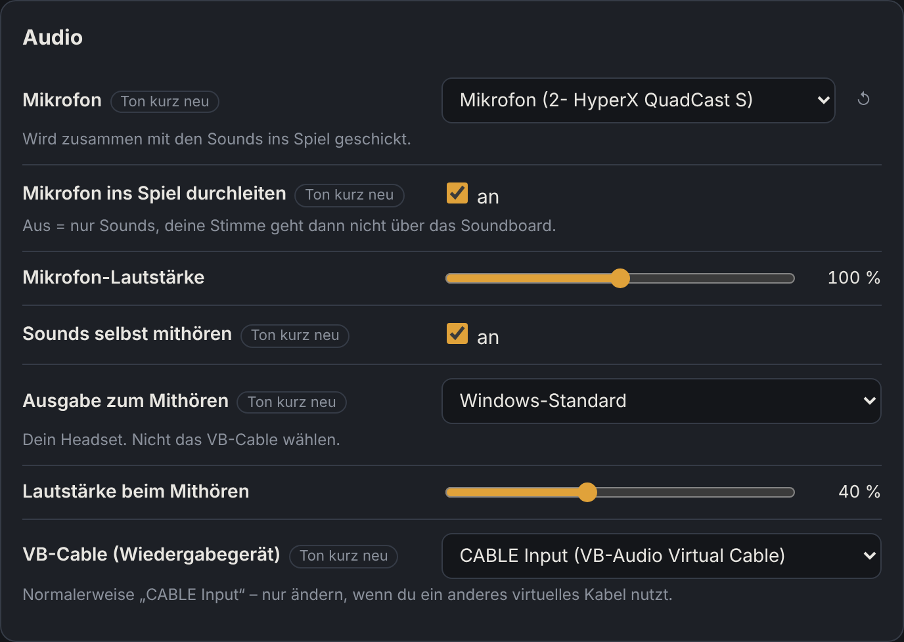

# Einstellungen

Ab Version 2.1 stellst du alles in der Oberfläche ein: Reiter **Einstellungen** (`http://localhost:8765/#einstellungen`). Ändern, **Speichern** – fertig. Du musst `soundboard.py` nicht mehr bearbeiten.

- Gespeichert wird in `sounds\settings.json`, und zwar nur, was vom Standard abweicht. Die Datei **bleibt bei Updates erhalten**, weil du beim Update nur die Programmdateien ersetzt.
- Geänderte, noch nicht gespeicherte Felder sind mit **•** markiert. **↺** setzt ein Feld auf den Standard zurück, **Alles auf Standard** alle Felder (wirksam erst mit **Speichern**). **Verwerfen** holt die gespeicherten Werte zurück.
- Kleine Hinweise neben dem Namen sagen, wann eine Änderung wirkt:
  - ohne Hinweis: **sofort**
  - **Ton kurz neu**: Audio startet beim Speichern kurz neu (Sekundenbruchteil Stille)
  - **lädt Sounds neu**: alle Seiten werden neu eingelesen
  - **ab nächstem Start** / **nach Neustart**: Soundboard einmal beenden und neu starten
- Neu angeschlossene Geräte erscheinen in den Auswahllisten nach einem Neustart des Soundboards.

## Audio

| Einstellung | Standard | Bedeutung |
|---|---|---|
| Mikrofon | Windows-Standard | Dein Mikrofon, z. B. *Mikrofon (2- HyperX QuadCast S)* |
| Mikrofon ins Spiel durchleiten | an | Aus = nur Sounds, deine Stimme geht nicht über das Soundboard |
| Mikrofon-Lautstärke | 100 % | bis 200 % |
| Sounds selbst mithören | an | Sounds zusätzlich im eigenen Headset |
| Ausgabe zum Mithören | Windows-Standard | dein Headset – **nicht** das VB-Cable |
| Lautstärke beim Mithören | 40 % | |
| VB-Cable (Wiedergabegerät) | CABLE Input | nur ändern, wenn du ein anderes virtuelles Kabel nutzt |

## Sounds

| Einstellung | Standard | Bedeutung |
|---|---|---|
| Lautstärke beim Start | 70 % | Startwert des Reglers auf der Soundboard-Seite |
| Leise Sounds automatisch anheben | an | Normalisierung beim Laden |
| Neuer Sound beendet laufende Sounds | an | aus = Sounds überlagern sich |
| Maximale Sound-Länge | 1,5 Minuten | längere Sounds werden gekürzt |
| Maximale Aufnahmelänge | 30 Sekunden | für **● Aufnehmen** |

## Sprechtaste (Push-to-Talk)

| Einstellung | Standard | Bedeutung |
|---|---|---|
| Sprechtaste beim Abspielen automatisch halten | an | aus = kein simulierter Tastendruck; im Spiel dann Sprachaktivierung nutzen |
| Sprechtaste im Spiel | `k` | **Taste drücken …** klicken und die Taste drücken. Numpad-Tasten sind für Sounds reserviert. |
| Nur wenn dieses Fenster aktiv ist | `WARDOGS` | Teil des Fenstertitels; leer = immer drücken (nicht empfohlen) |
| Vorlauf vor dem Sound | 0,15 s | Zeit zwischen Tastendruck und Soundstart |
| Nachlauf nach dem Sound | 0,25 s | so lange bleibt die Taste nach Soundende gedrückt |

## Seiten und Sprachausgabe

| Einstellung | Standard | Bedeutung |
|---|---|---|
| Bild ↑ / Bild ↓ wechseln die Seite | an | |
| Seitennamen im Headset ansagen | an | ohne Windows-Stimme: kurze Töne |
| Sprache der Windows-Stimme | `de` | Auswahl aus den installierten Stimmen |
| Sprechtempo | 0 | -10 (langsam) bis 10 (schnell) |
| NumLock nach Druck zurückschalten | an | |

## Weboberfläche und Start

| Einstellung | Standard | Bedeutung |
|---|---|---|
| Erreichbar von | Nur von diesem PC | **Auch vom Handy im Heimnetz** – siehe [Bedienung](Bedienung#vom-handy-bedienen) |
| Port | 8765 | nur ändern, wenn der Port belegt ist; die Desktopverknüpfung übernimmt ihn automatisch |
| Browser beim Start öffnen | an | gilt für `start.bat`; die Desktopverknüpfung öffnet die Oberfläche immer |
| Nach neuen Versionen suchen | an | beim Start und alle 12 Stunden bei GitHub nachfragen |

Gibt es eine neuere Version, erscheint oben in der Oberfläche ein grüner Hinweis mit Download-Link (pro Version ausblendbar). **Installiert wird nichts automatisch.**

## Links

Webseiten für die Desktopverknüpfung stellst du im Reiter **Links** ein, siehe [Links](Links).

## Für Fortgeschrittene

Die Standardwerte stehen weiterhin oben in `soundboard.py` (Abschnitt **Konfiguration**), dazu einige Werte ohne Feld in der Oberfläche, z. B. `MAX_VOLUME`, `LIMIT_THRESHOLD`, `NORMALIZE_PEAK`, `UPDATE_INTERVAL`. Werte aus `sounds\settings.json` haben Vorrang. Wer `soundboard.py` ändert, muss das nach jedem Update wiederholen.

`wardogs_start.pyw` (Desktopverknüpfung): `AUTO_QUIT` (Soundboard nach dem Spiel beenden), `GONE_GRACE` (20 s), `WAIT_FOR_GAME` (900 s).

## Befehlszeile

| Befehl | Wirkung |
|---|---|
| `python soundboard.py` | Soundboard starten |
| `python soundboard.py --list` | Audiogeräte auflisten |
| `python soundboard.py --no-browser` | ohne Browserfenster starten |
