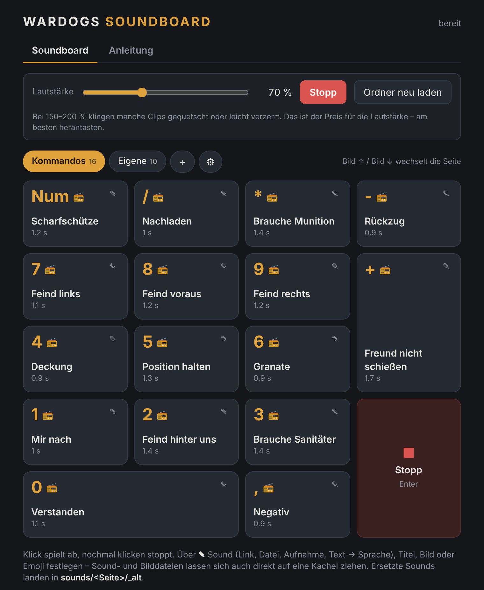
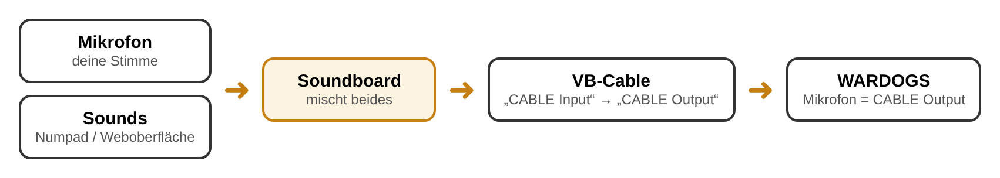

# WARDOGS Soundboard – Wiki

Willkommen! Das **WARDOGS Soundboard** spielt kurze Meme-Sounds per Numpad-Taste im Proximity-Voice-Chat von WARDOGS ab – so wie früher die Saysounds auf Counter-Strike-Servern. Deine Mitspieler in der Nähe hören die Sounds zusammen mit deiner Stimme.

**[⬇ Neueste Version herunterladen](https://github.com/TARLoki/wardogs-soundboard/releases/latest)**

## So funktioniert es

Das Spiel wird **nicht verändert**. Das Soundboard mischt dein Mikrofon mit den Sounds und gibt beides über das kostenlose virtuelle Audiokabel **VB-Cable** an WARDOGS weiter. Für das Spiel ist das ein ganz normales Mikrofon.

## Wiki-Seiten

| Seite | Inhalt |
|---|---|
| [Installation](Installation) | Download, Python, Pakete, VB-Cable, erster Start |
| [Spiel und Discord einrichten](Spiel-und-Discord-einrichten) | Mikrofon in WARDOGS, Push-to-Talk, Discord |
| [Seiten und Kommandos](Seiten-und-Kommandos) | Seiten, Bild ↑/↓, Kommando-Vorlage, Aufnahme, Text → Sprache, Funk-Effekt |
| [Sounds verwalten](Sounds-verwalten) | Myinstants-Links, eigene Dateien, Titel, Bilder und Emojis, Lautstärke |
| [Bedienung](Bedienung) | Tastenbelegung, Weboberfläche, Bedienung vom Handy |
| [Desktopverknüpfung](Desktopverknuepfung) | Soundboard und WARDOGS mit einem Klick starten |
| [Einstellungen](Einstellungen) | Alle Optionen in `soundboard.py` |
| [Fehlerbehebung](Fehlerbehebung) | Häufige Probleme und Lösungen |
| [FAQ](FAQ) | Anti-Cheat, Sicherheit, Urheberrecht |
| [English](English) | Short guide in English |

> **Inoffizielles Tool** – nicht mit Bulkhead verbunden oder von Bulkhead geprüft. Nutzung auf eigenes Risiko.
