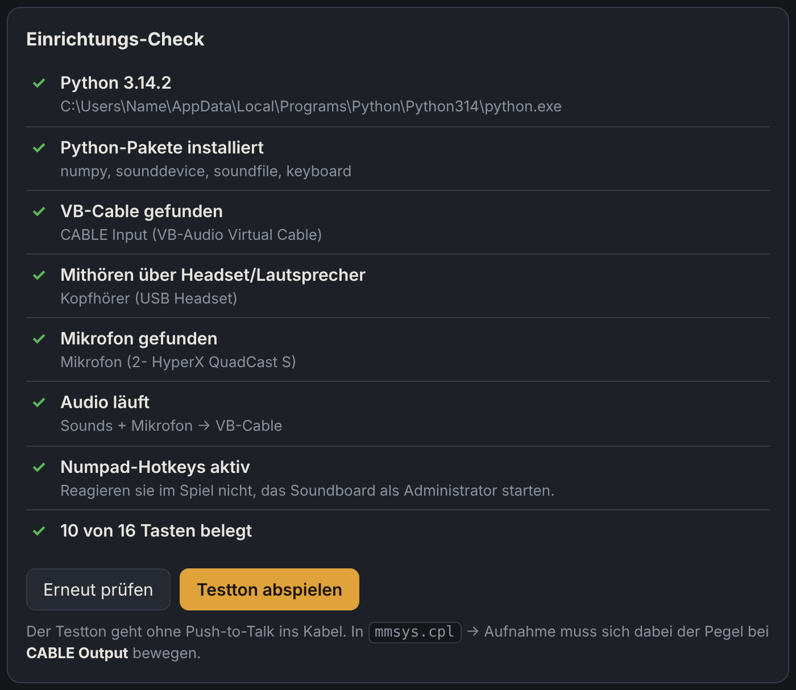

# Installation

Einmalig, etwa 15 Minuten. Du brauchst Windows 10/11, WARDOGS über Steam, ein Headset mit Mikrofon und eine Tastatur mit Nummernblock.

## 1. Herunterladen und entpacken

1. Unter **[Releases](https://github.com/TARLoki/wardogs-soundboard/releases/latest)** → „Assets“ die ZIP-Datei der neuesten Version herunterladen (z. B. `WARDOGS-Soundboard-v2.0.zip`).
2. **Vor dem Entpacken:** Rechtsklick auf die ZIP → **Eigenschaften** → unten **„Zulassen“** anhaken → **OK**.
   Sonst blockiert die *Intelligente App-Steuerung* (Smart App Control) später die `start.bat`.
3. Rechtsklick → **Alle extrahieren …** in einen eigenen Ordner, z. B. `C:\Spiele\WARDOGS-Soundboard`.

> ⚠️ **Nicht nach `C:\Programme` entpacken** – dort darf das Soundboard ohne Administratorrechte keine Sounds speichern.

## 2. Python installieren

1. Installer für **Python 3.14** von [python.org/downloads](https://www.python.org/downloads/) laden.
2. Im ersten Fenster ganz unten **„Add python.exe to PATH“** anhaken – der wichtigste Klick der ganzen Anleitung.
3. **Install Now**.
4. Ein **neues** PowerShell-Fenster öffnen und prüfen:

```
python --version
```

Erscheint `Python 3.14.x`, passt es. Neuere Versionen funktionieren meist auch; bei ganz frischen fehlen aber manchmal noch fertige Pakete.

## 3. Pakete installieren

In der PowerShell in den Soundboard-Ordner wechseln (Pfad anpassen):

```
cd "C:\Spiele\WARDOGS-Soundboard"
python -m pip install -r requirements.txt
```

Am Ende steht „Successfully installed …“. Gelbe Warnungen „… is not on PATH“ kannst du ignorieren.

> 💡 Tipp: Im Explorer im Soundboard-Ordner oben in die Adresszeile `powershell` tippen und Enter – dann öffnet sich die PowerShell direkt im richtigen Ordner.

## 4. VB-Cable installieren

1. [vb-audio.com/Cable](https://vb-audio.com/Cable/) öffnen und das ZIP für Windows laden.
2. Entpacken, `VBCABLE_Setup_x64.exe` per Rechtsklick **„Als Administrator ausführen“**.
3. **Install Driver** → **Rechner neu starten**.

Danach gibt es die Geräte **CABLE Input** (Wiedergabe) und **CABLE Output** (Aufnahme).

## 5. Windows-Sound prüfen

VB-Cable macht sich gern selbst zum Standardgerät. Das muss zurück:

1. **Windows-Taste + R** → `mmsys.cpl` → Enter.
2. Reiter **Wiedergabe**: **Headset** als Standard. CABLE Input darf **nicht** Standard sein.
3. Reiter **Aufnahme**: **Mikrofon** als Standard.

> ⚠️ Ist CABLE Input Standard-Wiedergabegerät, landet der komplette PC-Ton im Mikrofon. Das Soundboard erkennt das und meldet einen Fehler.

## 6. Soundboard starten

Doppelklick auf `start.bat` (oder `python soundboard.py`). Es öffnet sich ein Konsolenfenster und danach der Browser mit **http://localhost:8765**.

- Das Konsolenfenster **offen lassen**, solange du spielst – deine Stimme läuft jetzt durch das Soundboard. Minimieren ist okay.
- Lege für `http://localhost:8765` ein **Lesezeichen** an.
- Unter dem Menüpunkt **Anleitung** zeigt der **Einrichtungs-Check**, ob alles passt:

<p align="center"></p>

Weiter mit **[Spiel und Discord einrichten](Spiel-und-Discord-einrichten)**.
