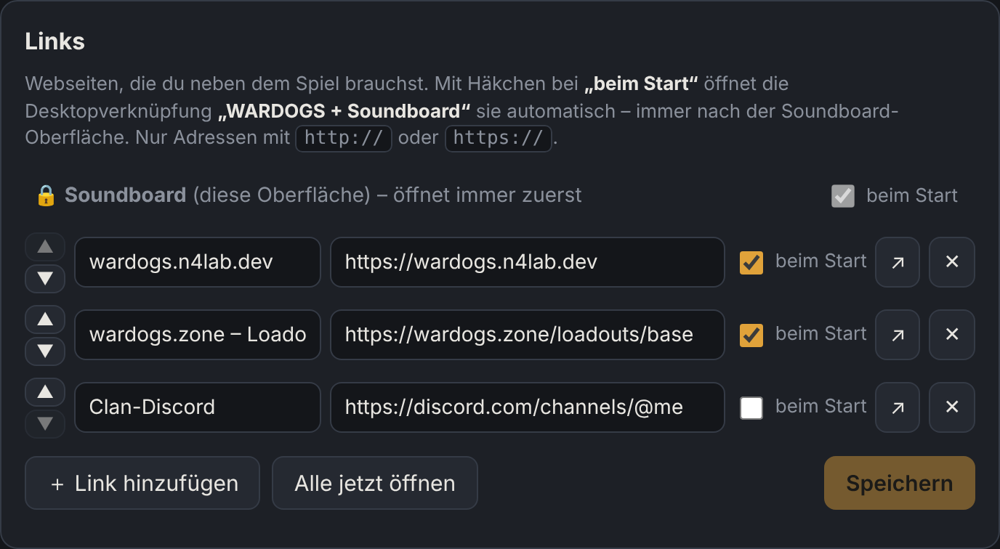

# Links

Im Reiter **Links** (`http://localhost:8765/#links`) legst du Webseiten fest, die du neben dem Spiel brauchst – z. B. Karten, Loadouts oder euren Clan-Discord im Browser.

| Feld | Bedeutung |
|---|---|
| Name | optional – leer = Adresse wird als Name verwendet |
| Adresse | nur `http://` oder `https://`; `wardogs.n4lab.dev` ohne Präfix wird zu `https://wardogs.n4lab.dev` |
| beim Start | Häkchen = die [Desktopverknüpfung](Desktopverknuepfung) öffnet die Seite automatisch |

- **▲ ▼** ändern die Reihenfolge (so öffnen sich auch die Tabs), **✕** entfernt einen Link, **↗** öffnet ihn sofort.
- **Alle jetzt öffnen** öffnet alle Links im Browser des PCs, auf dem das Soundboard läuft.
- **Speichern** nicht vergessen – ungültige Adressen werden rot markiert und nicht gespeichert.
- Die Soundboard-Oberfläche selbst öffnet sich beim Start **immer zuerst**, sie steht fest oben in der Liste.

Voreingestellt sind [wardogs.n4lab.dev](https://wardogs.n4lab.dev) und [wardogs.zone – Loadouts](https://wardogs.zone/loadouts/base), **ohne** Häkchen. Wer sie beim Start haben will, setzt einmal das Häkchen und speichert.

Gespeichert wird in `sounds\links.json` – bleibt bei Updates erhalten.
