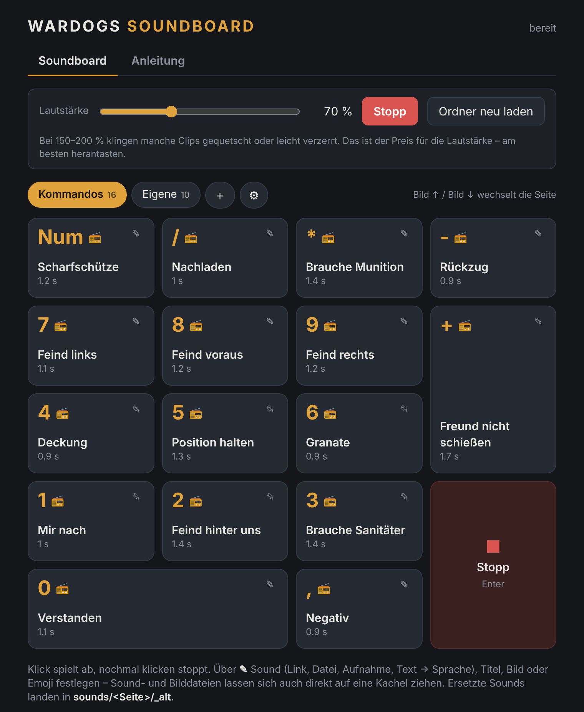
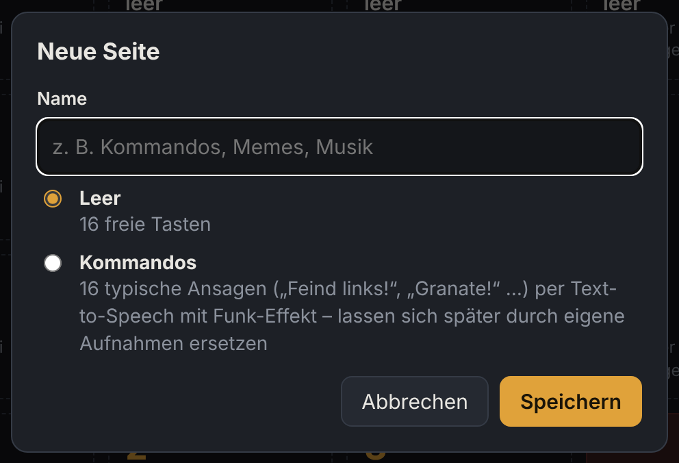
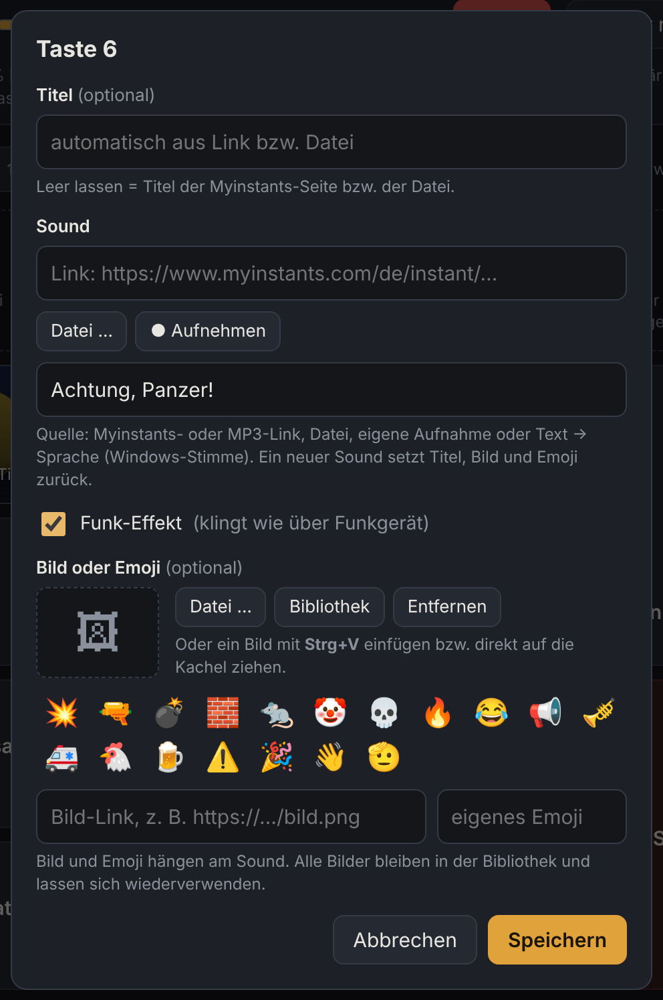

# Seiten und Kommandos

## Seiten

Das Soundboard kann beliebig viele **Seiten** haben – jede mit eigenen 16 Tasten, Titeln, Bildern und Effekten. Beim ersten Start gibt es zwei:

| Seite | Inhalt |
|---|---|
| **Kommandos** | 16 typische Ansagen per Text-to-Speech mit Funk-Effekt (siehe unten) |
| **Eigene** | deine eigenen Sounds – Sounds aus älteren Versionen landen automatisch hier |

### Umschalten

- **Im Spiel:** die eigenen Tasten **Bild ↑** (vorherige Seite) und **Bild ↓** (nächste Seite) über den Pfeiltasten. Der Seitenname wird **nur in deinem Headset** angesagt – die Mitspieler hören nichts davon.
- **In der Oberfläche:** auf den Reiter der Seite tippen.

Numpad 9 und 3 (die bei ausgeschaltetem NumLock ebenfalls „Bild ↑/↓“ senden) bleiben ganz normale Sound-Tasten.

> ⚠️ Das Soundboard fängt die Tasten nicht ab – WARDOGS bekommt Bild ↑/↓ ebenfalls. Sind sie im Spiel belegt, in den Steuerungseinstellungen prüfen. Abschalten mit `PAGE_KEYS = False`.

### Seiten verwalten

- **＋** neben den Reitern: neue Seite anlegen – **leer** oder mit der Vorlage **Kommandos**.
- **⚙**: aktuelle Seite umbenennen, nach links/rechts verschieben, freie Tasten mit Kommandos füllen oder löschen.
- Gelöschte Seiten werden nicht endgültig entfernt, sondern nach `sounds\_geloeschte_Seiten` verschoben.
- Jede Seite liegt in einem eigenen Ordner, z. B. `sounds\Kommandos`. Die Reihenfolge steht in `sounds\pages.json`.

## Kommando-Vorlage

| Taste | Kommando | Taste | Kommando |
|---|---|---|---|
| 7 | Feind links! | 1 | Mir nach! |
| 8 | Feind voraus! | 2 | Feind hinter uns! |
| 9 | Feind rechts! | 3 | Brauche Sanitäter! |
| 4 | Deckung! | 0 | Verstanden! |
| 5 | Position halten! | `,` | Negativ! |
| 6 | Granate! | `/` | Nachladen! |
| `*` | Brauche Munition! | `-` | Rückzug! |
| `+` | Freund, nicht schießen! | NumLock | Scharfschütze! |

Die Richtungen liegen wie auf dem Numpad: **7 links – 8 voraus – 9 rechts**, **2 hinten**.

Die Vorlage wird mit der **Windows-Sprachausgabe** erzeugt (nur unter Windows, ohne Internet) und klingt nach Navi – mit Funk-Effekt aber deutlich passender. Jede Taste lässt sich jederzeit durch eine **eigene Aufnahme** ersetzen.

## Quellen für Sounds

Im Dialog einer Taste (Stift **✎**):

| Quelle | So geht's |
|---|---|
| **Link** | Myinstants-Seite oder direkter MP3-Link ins Feld einfügen |
| **Datei …** | Sounddatei auswählen (oder auf die Kachel ziehen) |
| **● Aufnehmen** | über dein Mikrofon aufnehmen, **■ Stopp** beendet; Stille am Anfang und Ende wird abgeschnitten, max. 30 Sekunden. **▶ Anhören** spielt die Aufnahme nur in deinem Headset ab |
| **Text → Sprache** | Text eintippen, z. B. „Feind links!“ – die Windows-Stimme spricht ihn ein |

**Funk-Effekt** (Häkchen im Dialog): klingt wie über Funkgerät – schmaler Frequenzbereich, leichtes Rauschen, Klick am Anfang und „Ksch“ am Ende. Lässt sich für jede Taste einzeln an- und ausschalten, auch nachträglich. Kacheln mit Funk-Effekt tragen ein 📻.

> 💡 Aufnahmen am besten **außerhalb des Spiels** machen – während der Aufnahme läuft dein Mikrofon ganz normal weiter ins Spiel.

## Stimme für Text-to-Speech

Verwendet wird die erste installierte Windows-Stimme für Deutsch (`TTS_LANG = "de"`). Auf deutschem Windows ist das in der Regel **Microsoft Hedda**. Der Einrichtungs-Check zeigt unter „Sprachausgabe“, welche Stimme genutzt wird. Weitere Stimmen: Windows-Einstellungen → Zeit und Sprache → Sprache. Das Sprechtempo stellt `TTS_RATE` ein (-10 bis 10).
