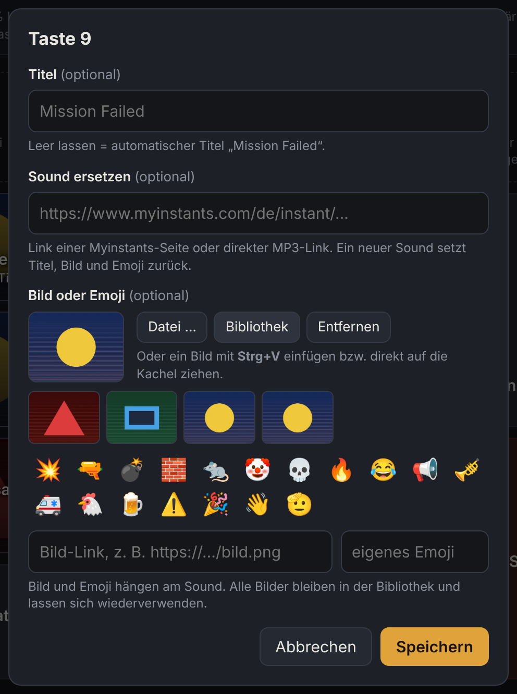

# Sounds verwalten

Die Oberfläche ist wie ein Nummernblock aufgebaut – jede Kachel ist eine Numpad-Taste, **16 Plätze pro Seite**. Alles auf dieser Seite gilt für die gerade gewählte [Seite](Seiten-und-Kommandos).

## Sound von Myinstants holen

1. Auf [myinstants.com](https://www.myinstants.com) einen Sound suchen.
2. Auf den **Namen** klicken (nicht auf den Abspielknopf) und die Adresse kopieren, z. B. `https://www.myinstants.com/de/instant/…`
3. Im Soundboard auf eine **leere Kachel** klicken (bei belegten auf den Stift **✎**).
4. Link ins Feld **Sound** einfügen → **Speichern**.

Bleibt das Titelfeld leer, wird automatisch der Titel der Myinstants-Seite verwendet.

## Weitere Quellen

Neben Myinstants-Links gibt es im Dialog **Datei …**, **● Aufnehmen** (übers Mikrofon) und **Text → Sprache** (Windows-Stimme), jeweils optional mit **Funk-Effekt** – Details unter [Seiten und Kommandos](Seiten-und-Kommandos#quellen-für-sounds).

## Eigene Dateien

WAV-, MP3-, OGG- oder FLAC-Datei aus dem Explorer **direkt auf eine Kachel ziehen**. Als Titel wird der Titel aus den Datei-Metadaten oder der Dateiname verwendet.

## Titel ändern

Stift **✎** → im Feld **Titel** einen eigenen Namen eintragen → **Speichern**. Das Feld **Sound** dabei leer lassen – der Sound bleibt erhalten. Titelfeld leeren = wieder automatischer Titel.

## Bild oder Emoji

Jede Taste kann ein **Bild** (als abgedunkelter Kachelhintergrund) oder ein **Emoji** bekommen – so lassen sich die Knöpfe besonders am Handy schneller auseinanderhalten.

Im Dialog (Stift **✎**) unter **„Bild oder Emoji“**:

| Weg | So geht's |
|---|---|
| **Datei …** | Bild von der Festplatte auswählen |
| **Strg+V** | Bild aus der Zwischenablage einfügen, z. B. einen Screenshot oder ein im Browser kopiertes Bild |
| **Bild-Link** | Adresse eines Bildes eintragen (muss direkt auf `.png`, `.jpg`, `.gif` oder `.webp` zeigen) |
| **Bibliothek** | ein früher verwendetes Bild antippen |
| **Emoji** | aus der Schnellauswahl antippen oder ein eigenes ins Feld eingeben |
| **Entfernen** | Bild bzw. Emoji von der Taste nehmen |

Schneller geht's per **Drag & Drop**: eine Bilddatei – oder ein Bild aus einem anderen Browserfenster – direkt auf die Kachel ziehen.

- Bild und Emoji **hängen am Sound**: Wird der Sound getauscht, verschwinden sie von der Taste (wie ein eigener Titel).
- Alle Bilder bleiben in der **Bibliothek** `sounds\images` und lassen sich jederzeit wieder zuweisen. Gleiche Bilder werden nur einmal gespeichert.
- Bilder werden beim Speichern automatisch verkleinert (max. 360 Pixel), die Bibliothek bleibt dadurch klein.
- Bild/Emoji geht nur auf Tasten, auf denen schon ein Sound liegt.
- Die Zuordnung steht je Seite in `art.json`. Nicht mehr benötigte Bilder kannst du einfach aus `sounds\images` löschen.

## Sound austauschen

Neuen Link im Dialog eintragen oder neue Datei auf die Kachel ziehen.

- Der alte Sound wird **nicht gelöscht**, sondern nach `sounds\<Seite>\_alt` verschoben.
- Eigener Titel, Bild und Emoji werden beim Austausch zurückgesetzt (außer du legst sie im selben Dialog gleich neu fest).

## Lautstärke

- Regler oben, **bis 200 %**. Ab etwa 150 % können manche Clips gequetscht oder leicht verzerrt klingen – herantasten.
- Leise Clips werden beim Laden automatisch angehoben (`NORMALIZE`).
- Ein Soft-Limiter verhindert hartes Übersteuern.

## Dateien im Ordner `sounds`

Jede Seite hat einen eigenen Unterordner, z. B. `sounds\Eigene`. Du kannst Dateien auch direkt dort hineinlegen und auf **„Ordner neu laden“** klicken. Der Anfang des Dateinamens bestimmt die Taste:

| Präfix | Taste | Präfix | Taste |
|---|---|---|---|
| `1_` … `9_` | Numpad 1–9 | `mal_` | `*` |
| `0_` | Numpad 0 | `minus_` | `-` |
| `komma_` | `,` | `plus_` | `+` |
| `geteilt_` | `/` | `num_` | NumLock |

Beispiel: `sounds\Eigene\plus_airhorn.mp3`. Dateien ohne Präfix füllen freie Plätze alphabetisch. Eigene Titel, Bilder/Emojis und Funk-Effekt stehen je Seite in `labels.json`, `art.json` und `fx.json`.

Sounds über **90 Sekunden** werden gekürzt (`MAX_SECONDS`), damit niemand versehentlich ganze Lieder abspielt.
