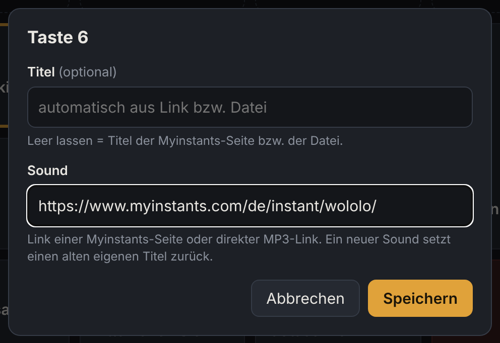

# Sounds verwalten

Die Oberfläche ist wie ein Nummernblock aufgebaut – jede Kachel ist eine Numpad-Taste, insgesamt **16 Plätze**.

## Sound von Myinstants holen

1. Auf [myinstants.com](https://www.myinstants.com) einen Sound suchen.
2. Auf den **Namen** klicken (nicht auf den Abspielknopf) und die Adresse kopieren, z. B. `https://www.myinstants.com/de/instant/…`
3. Im Soundboard auf eine **leere Kachel** klicken (bei belegten auf den Stift **✎**).
4. Link ins Feld **Sound** einfügen → **Speichern**.

Bleibt das Titelfeld leer, wird automatisch der Titel der Myinstants-Seite verwendet.

## Eigene Dateien

WAV-, MP3-, OGG- oder FLAC-Datei aus dem Explorer **direkt auf eine Kachel ziehen**. Als Titel wird der Titel aus den Datei-Metadaten oder der Dateiname verwendet.

## Titel ändern

Stift **✎** → im Feld **Titel** einen eigenen Namen eintragen → **Speichern**. Das Feld **Sound** dabei leer lassen – der Sound bleibt erhalten. Titelfeld leeren = wieder automatischer Titel.

## Sound austauschen

Neuen Link im Dialog eintragen oder neue Datei auf die Kachel ziehen.

- Der alte Sound wird **nicht gelöscht**, sondern nach `sounds\_alt` verschoben.
- Ein eigener Titel wird beim Austausch zurückgesetzt (außer du trägst im selben Dialog gleich einen neuen ein).

## Lautstärke

- Regler oben, **bis 200 %**. Ab etwa 150 % können manche Clips gequetscht oder leicht verzerrt klingen – herantasten.
- Leise Clips werden beim Laden automatisch angehoben (`NORMALIZE`).
- Ein Soft-Limiter verhindert hartes Übersteuern.

## Dateien im Ordner `sounds`

Du kannst Dateien auch direkt in den Ordner `sounds` legen und auf **„Ordner neu laden“** klicken. Der Anfang des Dateinamens bestimmt die Taste:

| Präfix | Taste | Präfix | Taste |
|---|---|---|---|
| `1_` … `9_` | Numpad 1–9 | `mal_` | `*` |
| `0_` | Numpad 0 | `minus_` | `-` |
| `komma_` | `,` | `plus_` | `+` |
| `geteilt_` | `/` | `num_` | NumLock |

Beispiel: `plus_airhorn.mp3`. Dateien ohne Präfix füllen freie Plätze alphabetisch. Eigene Titel stehen in `sounds\labels.json`.

Sounds über **90 Sekunden** werden gekürzt (`MAX_SECONDS`), damit niemand versehentlich ganze Lieder abspielt.
